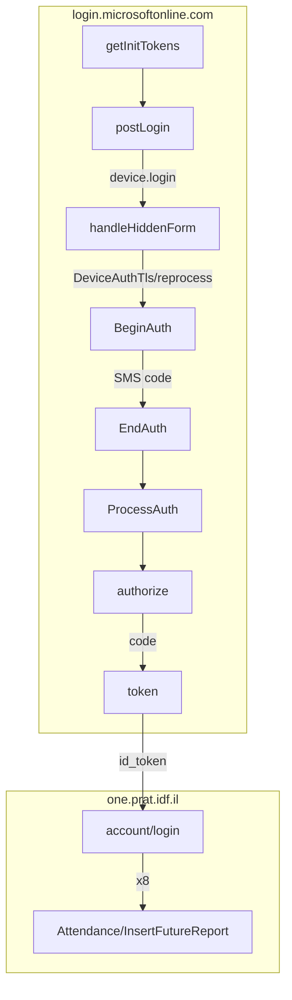

# Report-1-v2


Submits your weekly דוח 1 (Report 1) attendance on one.prat.idf.il from a JSON plan, with no browser.

The bot reproduces the site's Microsoft Entra sign-in with plain `fetch` calls (password, device
hidden-form hops, SMS multi-factor authentication, then the PKCE OAuth code exchange), logs into
the דוח 1 API with the resulting `id_token`, and posts one future attendance report for today and
for each of the next seven days, eight in all. What it reports per weekday comes from
[config/weeklyCalendarPlan.json](config/weeklyCalendarPlan.json), which you can edit by hand or
through the interactive [scripts/calendarSetup.ps1](scripts/calendarSetup.ps1) menu. The project
was started in March 2026.

## 📑 Table of Contents

- [Background](#-background)
- [Build](#-build)
- [Usage](#-usage)
- [Architecture](#-architecture)
- [Flow](#-flow)
- [Outputs](#-outputs)
- [Maintainers](#-maintainers)
- [Contributing](#-contributing)
- [License](#-license)

## 📖 Background

Filling in דוח 1 by hand means the same clicks every week. The site has no public API, so this
project was built by recording the browser's requests and replaying them: the login pages
embed their state in a `//< so the parsing code can be understood without a live session.

## 🔨 Build

### Node

Requires Node.js 22 or newer (the project relies on `--env-file` and `import ... with { type: "json" }`).

```bash
npm install
```

There is no compile step; the code runs straight from [src/](src/).

### Dependencies

| dependency | version | how it is obtained |
|---|---|---|
| `fetch-cookie` | ^3.2.0 | `npm install` |
| `tough-cookie` | ^6.0.1 | `npm install` |

Both wrap Node's built-in `fetch` so cookies persist across the login redirects.

## 🚀 Usage

1. Copy `.env.example` to `.env` and fill it in (see [Configuration](#configuration)).
2. Set your weekly plan, either by editing
   [config/weeklyCalendarPlan.json](config/weeklyCalendarPlan.json) directly or with the menu:

   ```bash
   npm run plan
   ```

   The script walks through Sunday to Saturday, offers the main and secondary attendance codes
   from [config/calendarCodes.json](config/calendarCodes.json) (shown in Hebrew), asks for an
   optional note, and writes the plan back out. Press Enter at any prompt to keep the current
   value. It runs in PowerShell, so this step is Windows only; on other platforms edit the JSON.
3. Run the bot:

   ```bash
   npm start
   ```

   or double-click [scripts/run_bot.bat](scripts/run_bot.bat). The bot signs in, asks you to
   type the SMS code it triggered, then submits the eight reports (today plus the next seven days) and prints a
   table of the API responses.

Each day's report uses the `MainCode`, `SecondaryCode` and `Note` of its weekday from the plan.
The `FutureReportDate` field in the plan file is a placeholder (`dd.mm.20YY`); the bot fills in
the real date for today and each of the next seven days at run time.

### Configuration

Environment variables, read from `.env` via `node --env-file`:

| variable | meaning |
|---|---|
| `USER_ID` | Your personal number. The bot signs in as `<USER_ID>@idf.il`. |
| `USER_PASSWORD` | Your Microsoft account password. |

Config files:

| file | purpose |
|---|---|
| [config/weeklyCalendarPlan.json](config/weeklyCalendarPlan.json) | One entry per weekday with `MainCode`, `SecondaryCode`, `Note` and `FutureReportDate`. |
| [config/calendarCodes.json](config/calendarCodes.json) | The attendance categories the site accepts: each primary code and its secondary codes, keyed by Hebrew label. Used only by the plan editor. |

`.env` and other secrets are ignored by git (see [.gitignore](.gitignore)); only `.env.example`
is tracked.

## 📂 Architecture

```
src/
  main.js                  entry point: login, דוח 1 session, submit the week
  microsoftLogin.js        Microsoft Entra sign-in, SMS MFA, PKCE token exchange
  calendarHandler.js       report-days helper (today plus seven) and the InsertFutureReport call
config/
  weeklyCalendarPlan.json  what to report on each weekday
  calendarCodes.json       attendance code catalogue for the plan editor
scripts/
  calendarSetup.ps1        interactive plan editor (npm run plan)
  run_bot.bat              double-click launcher (npm start)
examples/                  sanitised captures of the login pages and API payloads
```

## 🔀 Flow



1. `getInitTokens` fetches the login page and pulls `sFT`, `sCtx`, `canary` and `sessionId` out
   of its CDATA block.
2. `postLogin` posts the username and password. The response is a hidden form that
   `handleHiddenForm` submits twice: first to `device.login.microsoftonline.com`, then to the
   `DeviceAuthTls/reprocess` endpoint it redirects to. The final page yields fresh tokens.
3. `multiFactorAuth` calls `SAS/BeginAuth` with `OneWaySMS`, waits for you to type the code on
   stdin, posts it to `SAS/EndAuth`, then completes the step with `SAS/ProcessAuth`.
4. `finalAuthentication` generates a PKCE verifier and challenge, hits `/oauth2/v2.0/authorize`
   with `prompt=none`, reads the `code` from the redirect, and exchanges it at
   `/oauth2/v2.0/token` for an `id_token`.
5. `main` sends the `id_token` as the `Authorization` header to `/api/account/login`, then calls
   `updateCalendar` once for today and once for each of the next seven days.

All of the above shares one cookie jar, so the Entra session cookies (`ESTSAUTH` and friends)
and the דוח 1 session survive every redirect.

## 📤 Outputs

The bot listens on nothing. It makes these outbound calls:

| endpoint | purpose |
|---|---|
| `POST https://login.microsoftonline.com/<tenant>/login` | password sign-in |
| `POST https://login.microsoftonline.com/common/SAS/{BeginAuth,EndAuth,ProcessAuth}` | SMS MFA |
| `GET https://login.microsoftonline.com/<tenant>/oauth2/v2.0/authorize` | PKCE authorization code |
| `POST https://login.microsoftonline.com/<tenant>/oauth2/v2.0/token` | code to `id_token` exchange |
| `GET https://one.prat.idf.il/api/account/login` | דוח 1 session |
| `POST https://one.prat.idf.il/api/Attendance/InsertFutureReport` | one multipart form per day: `MainCode`, `SecondaryCode`, `Note`, `FutureReportDate` (`dd.mm.yyyy`) |

The bot writes no files; `npm run plan` is the only thing that rewrites
[config/weeklyCalendarPlan.json](config/weeklyCalendarPlan.json). Progress and the per-day API
responses go to stdout. A failed login, a missing weekday in the plan or a rejected report exits with status 1.

## 👤 Maintainers

[@CSGai](https://github.com/CSGai)

## 🤝 Contributing

Questions and bug reports go to the
[issue tracker](https://github.com/CSGai/Report-1-v2/issues). Pull requests are welcome; keep
commits in the Conventional Commits style used in this repo and never commit a real `.env` or
captured tokens.

## 📄 License

MIT © 2026 CSGai
